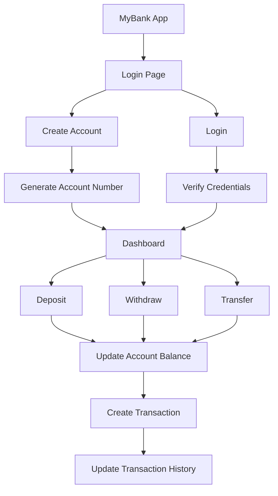

<div align="center">


<a href="https://git.io/typing-svg">
  
</a>

<br/>


</div>

---

## 📖 Overview

**MyBank** is a modern, responsive **Banking Management System** built with **HTML, CSS and Pure JavaScript**. It delivers a complete frontend banking experience: account creation, login, balance management, deposits, withdrawals, money transfers, transaction history, account details and PIN management.

Everything is stored in the browser using **LocalStorage** and **SessionStorage**, so there is **no backend and no database** to set up.

> [!WARNING]
> **Demo project only.** MyBank keeps account data and PINs in the browser. It has no secure backend, encrypted database or server-side authentication, so it must **not** be used with real financial information or real money.

---

## ✨ Features

<table>
  <tr>
    <td valign="top" width="50%">

### 🔐 Authentication
- Create a new bank account
- Auto-generated unique 10-digit account number
- 4-digit PIN login
- PIN confirmation at registration
- Logout and persistent login

    </td>
    <td valign="top" width="50%">

### 💰 Account Management
- View balance and account holder name
- View account number
- View account creation date
- Full account details page

    </td>
  </tr>
  <tr>
    <td valign="top">

### 💵 Banking Operations
- Deposit money
- Withdraw money
- Transfer to another account
- Automatic balance updates
- Invalid amount and insufficient balance checks
- Self-transfer prevention

    </td>
    <td valign="top">

### 📊 Dashboard
- Current balance
- Total deposits and withdrawals
- Total number of transactions
- Quick action buttons
- Recent transaction overview

    </td>
  </tr>
  <tr>
    <td valign="top">

### 🧾 Transactions
- Auto-generated transaction IDs
- Deposits, withdrawals, transfers sent and received
- Amount and balance after each transaction
- Date and time for every record

    </td>
    <td valign="top">

### 🔑 PIN Management
- Change your existing PIN
- Verify current PIN
- Validate new 4-digit PIN
- Confirm new PIN before updating

    </td>
  </tr>
</table>

### 📱 Responsive Design

Responsive dashboard, mobile-friendly navigation, a collapsible sidebar on small screens, responsive transaction tables and a modern card-based interface.

---

## 🛠️ Tech Stack

<div align="center">


</div>

| Technology | Purpose |
|---|---|
| **HTML5** | Application structure and UI elements |
| **CSS3** | Styling, responsive design, layouts and animations |
| **JavaScript** | Application logic and banking operations |
| **LocalStorage** | Persistent account and transaction data |
| **SessionStorage** | Current user session management |
| **Google Fonts** | Plus Jakarta Sans and Sora typography |

---

## 📸 Screenshots

<!--
Add screenshots to a "screenshots" folder in the repo, then uncomment the lines below.

<div align="center">
  
  
</div>
-->

*Screenshots coming soon.*

---

## 🚀 Getting Started

No backend server or database is required.

**1️⃣ Clone the repository**

```bash
git clone https://github.com/yatharth-kaushik/Banking-System-Web-App.git
```

**2️⃣ Open the project folder**

```bash
cd Banking-System-Web-App
```

**3️⃣ Run the app**

Open `index.html` in your browser.

> 💡 For a smoother experience, use the **VS Code Live Server** extension.

---

## 🔑 How to Use

<details open>
<summary><b>1️⃣ Create an Account</b></summary>

1. Click **Create New Account**
2. Enter your account holder name
3. Create and confirm a 4-digit PIN
4. Click **Create Account**
5. A unique 10-digit account number is generated

New accounts start with a balance of `₹0.00`.

</details>

<details>
<summary><b>2️⃣ Login</b></summary>

Enter your **10-digit account number** and **4-digit PIN**, then click **Login** to open the dashboard.

</details>

<details>
<summary><b>3️⃣ Check Balance</b></summary>

Shows your account holder name, account number and current balance.

</details>

<details>
<summary><b>4️⃣ Deposit Money</b></summary>

Enter an amount and click **Deposit**. The app validates the amount, updates your balance, creates a transaction record and refreshes the dashboard.

</details>

<details>
<summary><b>5️⃣ Withdraw Money</b></summary>

Enter an amount and click **Withdraw**. If your balance is too low, the withdrawal is rejected.

</details>

<details>
<summary><b>6️⃣ Transfer Money</b></summary>

Enter the receiver's account number and the amount. Both accounts are updated, and two records are created: **Transfer Sent** and **Transfer Received**.

</details>

<details>
<summary><b>7️⃣ Transaction History</b></summary>

Every transaction shows its ID, type, amount, balance after the transaction, and date and time.

Types: `Deposit` • `Withdraw` • `Transfer Sent` • `Transfer Received`

</details>

<details>
<summary><b>8️⃣ Change PIN</b></summary>

Enter your current PIN, a new 4-digit PIN, and confirm it. The current PIN must be correct and both new entries must match.

</details>

<details>
<summary><b>9️⃣ Logout</b></summary>

Click **Logout** in the sidebar to end your session.

</details>

---

## 🔄 Application Flow



---

## 🧮 Transaction System

Every successful operation creates a record containing:

```text
Transaction ID • Account Number • Transaction Type • Amount • Balance After • Date
```

Transaction IDs are generated sequentially using a counter stored in LocalStorage.

---

## 💾 Data Storage

| Storage | Key | Used for |
|---|---|---|
| LocalStorage | `mybank_accounts` | All accounts |
| LocalStorage | `mybank_transactions` | All transactions |
| LocalStorage | `mybank_currentUser` | Current logged-in user |
| LocalStorage | `mybank_txn_counter` | Sequential transaction IDs |
| SessionStorage | current account | Active session |

Data survives page refreshes because it's saved in the browser.

---

## 📂 Project Structure

```text
MyBank/
│
├── index.html    # All pages: login, register, dashboard, sections
├── style.css     # Dark glassmorphism UI and responsive layouts
├── script.js     # Account, transaction, PIN and rendering logic
└── README.md     # Project documentation
```

---

## 🎨 UI & Design

- 🌑 Dark navy color palette with teal/blue accents
- 🪟 Glass-style authentication cards
- 🔲 Rounded cards and buttons
- 📊 Dashboard statistics and sidebar navigation
- 🏷️ Transaction badges
- ✨ Hover effects and transitions
- 📱 Layouts for desktop, laptop, tablet and mobile

---

## 🔒 Security Considerations

The project demonstrates basic frontend validation:

- ✅ 10-digit account number validation
- ✅ 4-digit PIN validation and confirmation
- ✅ Current PIN verification
- ✅ Insufficient balance checking
- ✅ Self-transfer prevention
- ✅ Numeric input sanitization

Because authentication and storage are entirely client-side, this is a **learning/demo project, not a production banking system**.

---

## 🎯 Project Purpose

Demonstrates how a banking interface can be built with **HTML, CSS and JavaScript** without a backend, practicing:

`DOM manipulation` • `Event handling` • `Form validation` • `LocalStorage` • `SessionStorage` • `Functions` • `Array operations` • `Object-based data` • `Dynamic HTML rendering` • `Responsive design` • `Client-side state management`

---

## 🌱 Roadmap

- [ ] Backend integration with secure database storage
- [ ] PIN hashing
- [ ] Server-side and JWT/session-based authentication
- [ ] OTP verification
- [ ] Email/SMS notifications
- [ ] Admin dashboard
- [ ] Account deletion
- [ ] Transaction filtering and searching
- [ ] Export transactions as PDF/CSV
- [ ] Bank statement generation
- [ ] Multi-user backend support

---

## 📄 License

Created for **educational and learning purposes**. You are free to study, modify and improve the project for your own learning and development.

---

## 👨‍💻 Author

<div align="center">

**Yatharth Kaushik**

<a href="https://github.com/yatharth-kaushik"></a>
<a href="https://www.linkedin.com/in/yatharth-kaushik-92920a421/"></a>

<br/><br/>

⭐ **If you find this project useful, consider giving it a star!** ⭐


</div>
